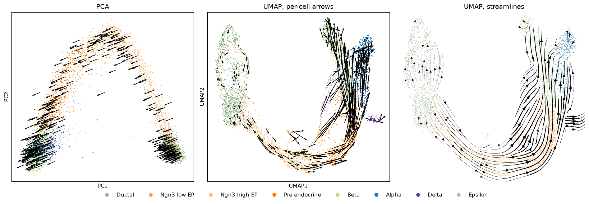

# ConstVelo

A probe of the evaluation, not a velocity method: every cell gets the same
unit gene-space velocity, from one cluster's mean `Ms` to another's. Holding
the velocity fixed, a score that moves across neighbour graphs or layouts is
moving because of the evaluation alone. It does not enter the ranking.

Compute the direction once, on one reference, and give the same matrix to
every configuration. `Ms` is used as it is when present; otherwise it is built
with 30 PCs and 30 neighbours, both changeable.

```python
import anndata as ad
import numpy as np
import veloeval as ve

c = ve.constvelo(ref30.copy(), start="Ductal", end="Beta")
for k, ref in references.items():                      # same c for every k
    m = ad.AnnData(obs=ref.obs[["clusters"]], var=ref.var[[]])
    m.layers["velocity"] = np.tile(c, (m.n_obs, 1)).astype(np.float32)
    m.var["velocity_genes"] = True
    ve.prepare(m, reference=ref)
```

On scVelo's pancreas data — 2000 HVGs, Ductal to Beta, 30 PCs and 30
neighbours: in PCA every cell carries the same arrow, while on the UMAP the
arrows scVelo projects through the velocity graph, and the streamlines, bend
with the neighbourhood. Pancreas branches into four lineages, so one direction
is an idealised example, right only roughly.



The figure comes from `docs/_scripts/constvelo_pancreas.py`.

```{eval-rst}
.. autofunction:: veloeval.constvelo
```
