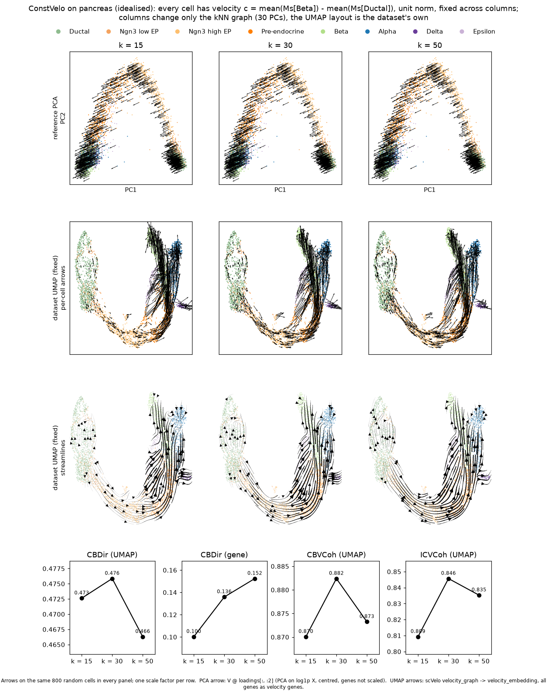
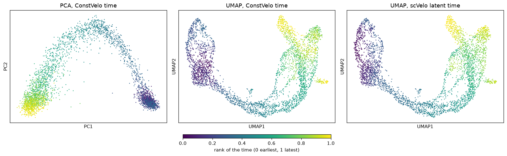

# ConstVelo

A probe of the evaluation, not a velocity method: every cell gets the same
unit gene-space velocity, from one cluster's mean `Ms` to another's. Holding
the velocity fixed, a score that moves across neighbour graphs or layouts is
moving because of the evaluation alone. It does not enter the ranking.

Compute the direction once, on one reference, and give the same matrix to
every configuration. `Ms` is used as it is when present; otherwise it is built
with 30 PCs and 30 neighbours, both changeable.

```python
import anndata as ad
import numpy as np
import veloeval as ve

base = ref30.copy()
c = ve.constvelo(base, start="Ductal", end="Beta")
for k, ref in references.items():                      # same c for every k
    m = ad.AnnData(obs=ref.obs[["clusters"]], var=ref.var[[]])
    m.layers["velocity"] = np.tile(c, (m.n_obs, 1)).astype(np.float32)
    m.var["velocity_genes"] = True
    m.obs["constvelo_time"] = base.obs["constvelo_time"]  # same time too
    ve.prepare(m, reference=ref)
```

On scVelo's pancreas data — 2000 HVGs, Ductal to Beta, 30 PCs and 30
neighbours: in PCA every cell carries the same arrow, while on the UMAP the
arrows scVelo projects through the velocity graph, and the streamlines, bend
with the neighbourhood. Pancreas branches into four lineages, so one direction
is an idealised example, right only roughly.



The figure comes from `docs/_scripts/constvelo_pancreas.py`.

Every constant field scores 0 on {func}`~veloeval.metrics.cbturn`, which keeps
only the part of the velocity that changes from one cluster edge to the next.

## Its own time

Under one velocity *c* for every cell, a cell at $x_i$ has travelled
$t_i = \langle x_i, c \rangle - \min_j \langle x_j, c \rangle$ along it: the
field's exact time, with no root, end or parameter to choose. `constvelo`
writes it to `obs['constvelo_time']`, on the same `Ms` as *c*, and
{func}`~veloeval.prepare` keeps it as the method's own time. It is the
reference row for the time metrics, as the velocity is for the direction ones:
how much order one straight line gives.

```python
M.cto(m, label_key="clusters", cluster_edges=edges, time_key="constvelo_time")
```

scVelo's velocity pseudotime is not this time: it is a diffusion on the kNN
graph, with the velocity only choosing the root, so it orders cells well
whatever the velocity. On pancreas (7 edges, scvelo 0.3.4):

| velocity | time | CTO |
| --- | --- | --- |
| scVelo dynamical | `latent_time` | 0.919 |
| scVelo dynamical | velocity pseudotime | 0.940 |
| ConstVelo, Ductal to Beta | `constvelo_time` | 0.890 |
| ConstVelo, Ductal to Beta | velocity pseudotime | 0.946 |
| Gaussian noise | velocity pseudotime | 0.072 |

The pseudotime of a constant field beats scVelo's own latent time, and pure
noise orders the cells almost perfectly, backwards from a misplaced root. The
straight line falls 0.03 short of the latent time, nearly all of it on
Ductal to Ngn3 low EP (0.54): in `Ms`, not log-transformed, the early cells sit
close together and the hormone genes dominate *c*. Drawn as ranks, the two
times are hard to tell apart along the trajectory:



The figure comes from `docs/_scripts/constvelo_time_pancreas.py`.

```{eval-rst}
.. autofunction:: veloeval.constvelo
```
