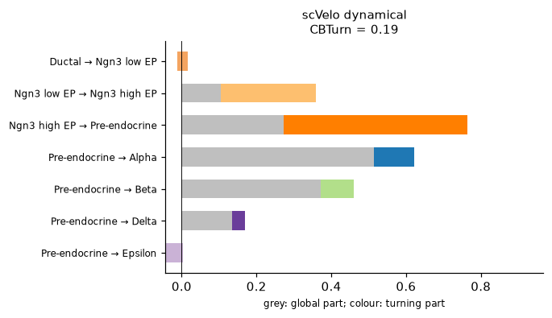
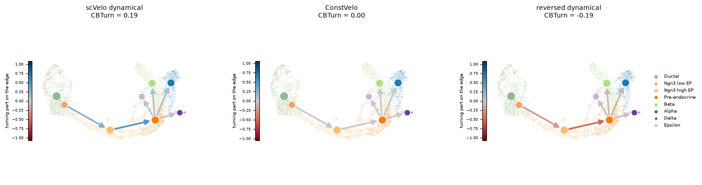

# Plots

Pictures of what a metric measured, for reading one result rather than a
table of them. They need matplotlib: `pip install "veloeval[plot]"`.

## Field constancy

{func}`~veloeval.metrics.field_constancy` gives one number, $R$, the length of
the mean unit velocity. The plot shows where it comes from: every cell's
angle to the mean direction, 0° pointing with it and 180° against it, as
wedges whose area counts cells, stacked by cell type. The arrow is $R$ on the
scale of the dashed half-circle — and also the mean cosine of every cell with
the mean direction.

The grey band is a yardstick: where directions drawn at random would fall, in
as many genes as the velocity has (±2 sd). With a thousand genes nearly all of
them are within a few degrees of 90°, so a cell type in the band points no
more along the mean than noise would. A constant field such as
{func}`~veloeval.constvelo` puts every cell at 0°.

```python
import veloeval as ve

ve.pl.field_constancy(adata, label_key="clusters", title="scVelo dynamical")
```


```{eval-rst}
.. autofunction:: veloeval.pl.field_constancy
```

## CBTurn

The agreement of each edge's mean boundary velocity with the edge's direction
— a centroid version of {func}`~veloeval.metrics.cbdir` — splits exactly into
two parts. The turning part is what the edge's velocity shares with what sets
the edge apart from the other edges; {func}`~veloeval.metrics.cbturn` is its
sum over edges, scaled. The global part is the rest, and averaged over edges
it is one direction shared by all of them. A constant field has no turning
part on any edge.

`cbturn_parts` on one method gives a bar per edge, the turning part in the
target cell type's colour:

```python
ve.pl.cbturn_parts(adata, ref, label_key="clusters", cluster_edges=edges)
```



`cbturn` puts the same turning parts on the differentiation topology, as in
scVelo's PAGA plot: each cell type a node at the median of its cells in the
UMAP, each edge an arrow from source to target, blue where the velocity turns
with the edge, red where against it, grey where nothing sets the edge apart.
Full colour is the most an edge could reach, so colours compare across
methods. The UMAP only places the nodes; the scores are computed in gene space.

```python
ve.pl.cbturn(adata, ref, label_key="clusters", cluster_edges=edges)
```



Given several methods by name, `cbturn_parts` averages both parts over edges,
one bar per method:

```python
runs = {"scVelo dynamical": dyn, "ConstVelo": const}   # prepared on ref
ve.pl.cbturn_parts(runs, ref, label_key="clusters", cluster_edges=edges)
```


ConstVelo scores the highest of all on the global part and nothing on the
turning part. The figures come from `docs/_scripts/cbturn_pancreas.py`.

```{eval-rst}
.. autofunction:: veloeval.pl.cbturn

.. autofunction:: veloeval.pl.cbturn_parts
```
