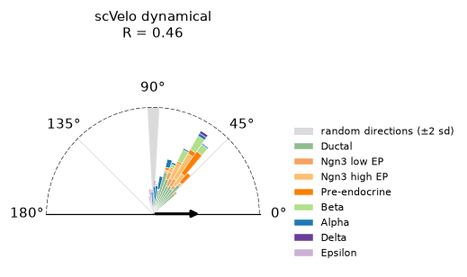
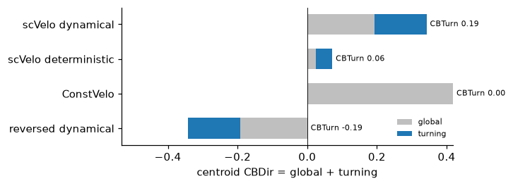
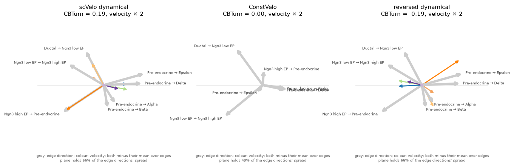

# Plots

Pictures of what a metric measured, for reading one result rather than a
table of them. They need matplotlib: `pip install "veloeval[plot]"`.

## Field constancy

{func}`~veloeval.metrics.field_constancy` gives one number, $R$, the length of
the mean unit velocity. The plot shows where it comes from: every cell's
angle to the mean direction, 0° pointing with it and 180° against it, as
wedges whose area counts cells, stacked by cell type. The arrow is $R$ on the
scale of the dashed half-circle — and also the mean cosine of every cell with
the mean direction. The grey band at 90° is where random directions fall in as
many genes: in gene space, a cell there points nowhere in particular.

```python
import veloeval as ve

ve.pl.field_constancy(adata, label_key="clusters", title="scVelo dynamical")
```

On pancreas — 2000 HVGs, 30 PCs and 30 neighbours:



ConstVelo puts every cell at 0°. Both scVelo models keep their cells well off
the random band, at different angles for different cell types. The figure
comes from `docs/_scripts/field_constancy_pancreas.py`.

```{eval-rst}
.. autofunction:: veloeval.pl.field_constancy
```

## CBTurn

{func}`~veloeval.metrics.cbturn` regresses what changes in the velocity from
one cluster edge to the next on what changes in the data. Two plots show it.

`cbturn_parts` compares methods. Averaged over edges, the agreement of each
edge's mean boundary velocity with its direction — a centroid version of
CBDir — splits exactly into a global part, one direction shared by every edge,
and a turning part:

```python
runs = {"scVelo dynamical": dyn, "ConstVelo": const}   # prepared on ref
ve.pl.cbturn_parts(runs, ref, label_key="clusters", cluster_edges=edges)
```



ConstVelo scores the highest of all on the global part and nothing on the
turning part.

`cbturn` reads one method. Each edge's direction minus the mean over edges is
a grey arrow; the mean unit velocity of its boundary cells minus the mean over
edges is a coloured one, in the target cluster's colour, lengthened by the
factor in the title. Both are drawn in the plane holding most of the spread of
the edge directions.

```python
ve.pl.cbturn(dyn, ref, label_key="clusters", cluster_edges=edges)
```



The dynamical model's arrows follow most of the grey ones, the reversed
field's point against them, and ConstVelo has none. Its grey arrows differ from
the others' because it scores all 2000 genes rather than the dynamical model's
velocity genes. Both figures come from `docs/_scripts/cbturn_pancreas.py`.

```{eval-rst}
.. autofunction:: veloeval.pl.cbturn

.. autofunction:: veloeval.pl.cbturn_parts
```
